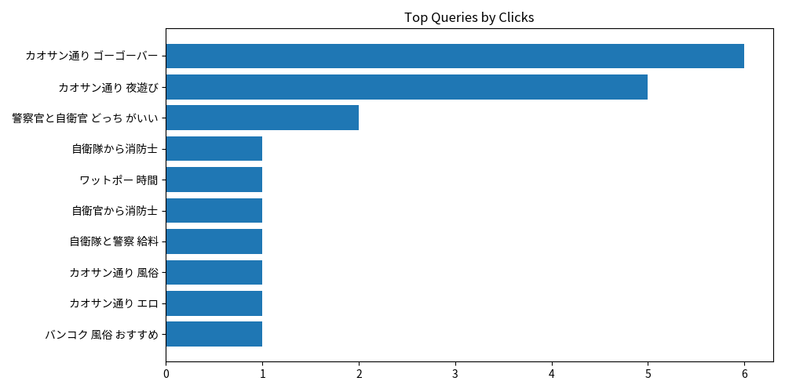

# Weekly SEO Report

## Executive Summary

Search clicks changed by -56.6% WoW (23 vs 53). Impressions changed by -32.6% WoW (627 vs 930). CTR is 3.7% (-2.0pt WoW). Avg position is 33.24 (+1.28 WoW). Top gaining query: "警察官と自衛官 どっち がいい" (+2 clicks). Top losing query: "カオサン通り 風俗" (-4 clicks). GA4 sessions changed by 1.1% WoW (380 vs 376). Top traffic channel: Direct.

- Current: **2026-11-09 → 2026-11-15**
- Previous: **2026-11-02 → 2026-11-08**
- Generated: 2026-11-16 00:55 UTC

## Google Search Console – Top Queries (WoW)
| query             |   clicks |   clicks_prev |   clicks_delta | clicks_pct   |   impressions | ctr    |   position |
|:------------------|---------:|--------------:|---------------:|:-------------|--------------:|:-------|-----------:|
| カオサン通り ゴーゴーバー     |        6 |             9 |             -3 | -33.3%       |             9 | 66.7%  |       1    |
| カオサン通り 夜遊び        |        5 |             6 |             -1 | -16.7%       |            36 | 13.9%  |       3.08 |
| 警察官と自衛官 どっち がいい   |        2 |             0 |              2 | —            |            16 | 12.5%  |       5.81 |
| 自衛隊から消防士          |        1 |             0 |              1 | —            |            14 | 7.1%   |       4.57 |
| ワットポー 時間          |        1 |             0 |              1 | —            |            12 | 8.3%   |       5.42 |
| 自衛官から消防士          |        1 |             1 |              0 | 0.0%         |             5 | 20.0%  |       5.8  |
| 自衛隊と警察 給料         |        1 |             0 |              1 | —            |             5 | 20.0%  |       4.2  |
| カオサン通り 風俗         |        1 |             5 |             -4 | -80.0%       |             3 | 33.3%  |       2    |
| カオサン通り エロ         |        1 |             0 |              1 | —            |             2 | 50.0%  |       2    |
| バンコク 風俗 おすすめ      |        1 |             0 |              1 | —            |             2 | 50.0%  |      10    |
| ウブド 観光 モデルコース     |        1 |             0 |              1 | —            |             1 | 100.0% |      13    |
| オカダマニラカジノ         |        1 |             0 |              1 | —            |             1 | 100.0% |      22    |
| バリ島 キャッシング        |        1 |             0 |              1 | —            |             1 | 100.0% |       3    |
| booking           |        0 |             0 |              0 | —            |            13 | 0.0%   |      15    |
| khao san road     |        0 |             0 |              0 | —            |            11 | 0.0%   |      35.36 |
| カオサン通り            |        0 |             0 |              0 | —            |            11 | 0.0%   |      14.64 |
| ネイティブキャンプ 評判      |        0 |             0 |              0 | —            |            11 | 0.0%   |      59.73 |
| google 検索順位 おかしい  |        0 |             0 |              0 | —            |            10 | 0.0%   |      44.7  |
| best cafes canggu |        0 |             0 |              0 | —            |             9 | 0.0%   |      63.56 |
| canggu cafes      |        0 |             0 |              0 | —            |             9 | 0.0%   |      72.89 |

## Google Analytics (GA4) – Sessions by Channel (WoW)
| channel_group   |   sessions |   sessions_prev |   sessions_delta | sessions_pct   |   total_users |
|:----------------|-----------:|----------------:|-----------------:|:---------------|--------------:|
| Direct          |        219 |             130 |               89 | 68.5%          |           217 |
| Organic Search  |        148 |             186 |              -38 | -20.4%         |           136 |
| Referral        |          6 |              54 |              -48 | -88.9%         |             6 |
| AI Assistant    |          4 |               5 |               -1 | -20.0%         |             2 |
| Organic Social  |          2 |               0 |                2 | —              |             2 |
| Unassigned      |          1 |               1 |                0 | 0.0%           |             1 |

## Visuals

## Notes / Next Actions
- Rankings slightly weakened WoW—review pages losing positions and strengthen internal links around those topics.
- CTR decreased WoW—test title/meta updates for high-impression queries and validate SERP intent alignment.
- Investigate the largest click drops (Queries → Pages) and check indexability/canonical/internal-link changes.
- New queries appeared WoW—map them to landing pages and expand content clusters to capture more long-tail demand.
- Organic Search sessions dropped WoW—compare GSC clicks vs GA4 landing pages to locate the main decline pages.
