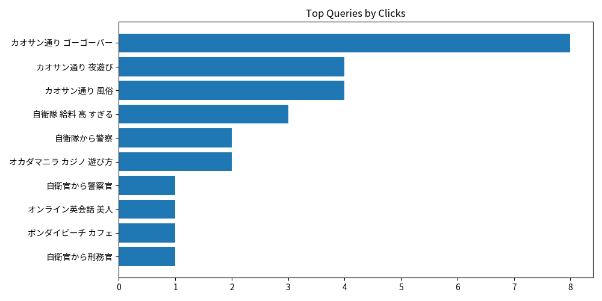

# Weekly SEO Report

## Executive Summary

Search clicks changed by 26.1% WoW (29 vs 23). Impressions changed by -15.3% WoW (666 vs 786). CTR is 4.4% (+1.4pt WoW). Avg position is 32.92 (-1.08 WoW). Top gaining query: "ワットポー 時間" (+2 clicks). Top losing query: "srsltid" (-1 clicks). GA4 sessions changed by 31.8% WoW (282 vs 214). Top traffic channel: Organic Search.

- Current: **2026-10-26 → 2026-11-01**
- Previous: **2026-10-19 → 2026-10-25**
- Generated: 2026-11-02 00:35 UTC

## Google Search Console – Top Queries (WoW)
| query                |   clicks |   clicks_prev |   clicks_delta | clicks_pct   |   impressions | ctr    |   position |
|:---------------------|---------:|--------------:|---------------:|:-------------|--------------:|:-------|-----------:|
| カオサン通り ゴーゴーバー        |        6 |             6 |              0 | 0.0%         |            13 | 46.2%  |       1    |
| カオサン通り 夜遊び           |        5 |             4 |              1 | 25.0%        |            29 | 17.2%  |       4.62 |
| オペラハウス プロジェクションマッピング |        2 |             0 |              2 | —            |            13 | 15.4%  |       1.85 |
| ワットポー 時間             |        2 |             0 |              2 | —            |            13 | 15.4%  |       4.08 |
| ワットポー 所要時間           |        1 |             0 |              1 | —            |            13 | 7.7%   |       7.23 |
| 自衛隊から警察              |        1 |             1 |              0 | 0.0%         |             9 | 11.1%  |       5    |
| 47 都 道府県 制覇 費用       |        1 |             0 |              1 | —            |             7 | 14.3%  |       4.86 |
| 自衛官から消防士             |        1 |             0 |              1 | —            |             6 | 16.7%  |       4.33 |
| 自衛隊から警察官             |        1 |             0 |              1 | —            |             6 | 16.7%  |       3.67 |
| インドネシア キャッシング        |        1 |             0 |              1 | —            |             5 | 20.0%  |       6.8  |
| オカダマニラ 服装            |        1 |             0 |              1 | —            |             2 | 50.0%  |      11.5  |
| 自衛隊から警察に転職           |        1 |             0 |              1 | —            |             2 | 50.0%  |       3    |
| 警察と自衛隊どっちがいい         |        1 |             0 |              1 | —            |             2 | 50.0%  |       9    |
| カオサン 風俗              |        1 |             0 |              1 | —            |             1 | 100.0% |       1    |
| バンコク コワーキングスペース      |        1 |             0 |              1 | —            |             1 | 100.0% |       6    |
| 台湾 猫空 カフェ            |        1 |             0 |              1 | —            |             1 | 100.0% |      10    |
| 自衛官 再任用              |        1 |             0 |              1 | —            |             1 | 100.0% |      33    |
| 自衛官 若年給付金 3 回目 いくら   |        1 |             0 |              1 | —            |             1 | 100.0% |      37    |
| ネイティブキャンプ 評判         |        0 |             0 |              0 | —            |            18 | 0.0%   |      52.89 |
| khao san road        |        0 |             0 |              0 | —            |            15 | 0.0%   |      26.07 |

## Google Analytics (GA4) – Sessions by Channel (WoW)
| channel_group   |   sessions |   sessions_prev |   sessions_delta | sessions_pct   |   total_users |
|:----------------|-----------:|----------------:|-----------------:|:---------------|--------------:|
| Organic Search  |        155 |             138 |               17 | 12.3%          |           139 |
| Direct          |         97 |              63 |               34 | 54.0%          |            97 |
| Referral        |         27 |               4 |               23 | 575.0%         |            27 |
| AI Assistant    |          2 |               3 |               -1 | -33.3%         |             1 |
| Unassigned      |          1 |               0 |                1 | —              |             1 |

## Visuals

## Notes / Next Actions
- New queries appeared WoW—map them to landing pages and expand content clusters to capture more long-tail demand.
- Organic Search sessions grew WoW—double down on winning pages (refresh content + add internal links).
