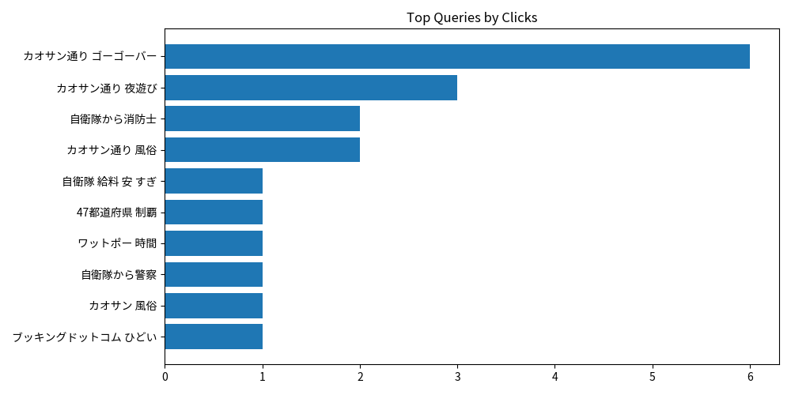

# Weekly SEO Report

## Executive Summary

Search clicks changed by -65.9% WoW (15 vs 44). Impressions changed by -20.2% WoW (679 vs 851). CTR is 2.2% (-3.0pt WoW). Avg position is 31.75 (+3.96 WoW). Top gaining query: "srsltid" (+1 clicks). Top losing query: "カオサン通り ゴーゴーバー" (-3 clicks). GA4 sessions changed by -25.7% WoW (214 vs 288). Top traffic channel: Organic Search.

- Current: **2026-10-19 → 2026-10-25**
- Previous: **2026-10-12 → 2026-10-18**
- Generated: 2026-10-25 23:10 UTC

## Google Search Console – Top Queries (WoW)
| query                 |   clicks |   clicks_prev |   clicks_delta | clicks_pct   |   impressions | ctr   |   position |
|:----------------------|---------:|--------------:|---------------:|:-------------|--------------:|:------|-----------:|
| カオサン通り ゴーゴーバー         |        5 |             8 |             -3 | -37.5%       |            10 | 50.0% |       1.1  |
| カオサン通り 夜遊び            |        2 |             3 |             -1 | -33.3%       |            24 | 8.3%  |       4.38 |
| 自衛隊から消防士              |        1 |             2 |             -1 | -50.0%       |            20 | 5.0%  |       4.6  |
| 自衛官 退職金 計算            |        1 |             0 |              1 | —            |            13 | 7.7%  |      10.31 |
| 自衛隊から警察               |        1 |             2 |             -1 | -50.0%       |            11 | 9.1%  |       4.45 |
| srsltid               |        1 |             0 |              1 | —            |            10 | 10.0% |      50.7  |
| カオサン通り 風俗             |        1 |             2 |             -1 | -50.0%       |             5 | 20.0% |       1.4  |
| ワットポー 地図              |        1 |             1 |              0 | 0.0%         |             5 | 20.0% |       1    |
| オカダマニラ ktv            |        1 |             0 |              1 | —            |             3 | 33.3% |       6    |
| バリ島 atm               |        1 |             0 |              1 | —            |             2 | 50.0% |       5    |
| 47都道府県 制覇             |        0 |             1 |             -1 | -100.0%      |            14 | 0.0%  |      12.14 |
| canggu cafes          |        0 |             0 |              0 | —            |            14 | 0.0%  |      73.93 |
| booking com           |        0 |             0 |              0 | —            |            13 | 0.0%  |       6.54 |
| フリーランス 見積書            |        0 |             0 |              0 | —            |            12 | 0.0%  |      49.58 |
| best cafes in canggu  |        0 |             0 |              0 | —            |            11 | 0.0%  |      77.18 |
| booking               |        0 |             0 |              0 | —            |            11 | 0.0%  |       6.55 |
| best cafes canggu     |        0 |             0 |              0 | —            |            10 | 0.0%  |      74.9  |
| best coffee in canggu |        0 |             0 |              0 | —            |            10 | 0.0%  |      83.7  |
| ブッキング ドット コム          |        0 |             0 |              0 | —            |            10 | 0.0%  |      17.8  |
| ネイティブキャンプ 評判          |        0 |             0 |              0 | —            |             9 | 0.0%  |      48.89 |

## Google Analytics (GA4) – Sessions by Channel (WoW)
| channel_group   |   sessions |   sessions_prev |   sessions_delta | sessions_pct   |   total_users |
|:----------------|-----------:|----------------:|-----------------:|:---------------|--------------:|
| Organic Search  |        138 |             178 |              -40 | -22.5%         |           129 |
| Direct          |         63 |             100 |              -37 | -37.0%         |            63 |
| Organic Social  |          6 |               5 |                1 | 20.0%          |             3 |
| Referral        |          4 |               4 |                0 | 0.0%           |             4 |
| AI Assistant    |          3 |               0 |                3 | —              |             2 |

## Visuals

## Notes / Next Actions
- Rankings slightly weakened WoW—review pages losing positions and strengthen internal links around those topics.
- CTR decreased WoW—test title/meta updates for high-impression queries and validate SERP intent alignment.
- Investigate the largest click drops (Queries → Pages) and check indexability/canonical/internal-link changes.
- New queries appeared WoW—map them to landing pages and expand content clusters to capture more long-tail demand.
- Organic Search sessions dropped WoW—compare GSC clicks vs GA4 landing pages to locate the main decline pages.
